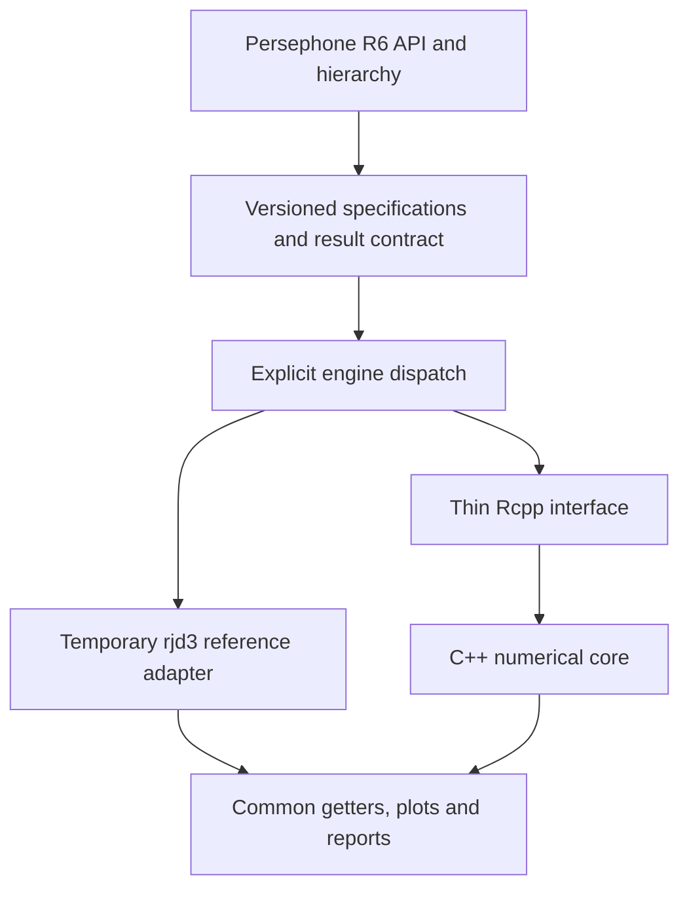

# Numerical roadmap after the repository split

Kalos owns numerical items 16, 18–25. rkalos owns R conversion and R package
qualification; Persephone owns application items 6–15, integration item 17,
product parity 26 and default cutover 27. Item numbers are retained for continuity.

Current delivered numerical scope is through **22b.2**, including all later
covariance, Java-free legacy, residual, interpolation, forecast, MSR and initial
X-11 additions. Full fitting remains unavailable. The current concise delivery
status and next decisions are in [IMPLEMENTATION_STATUS.md](../IMPLEMENTATION_STATUS.md).

The following detailed acceptance plan was transferred from the split baseline.
References to embedded `src/core`, `tools/reference`, `tools/native-tests` and
native R helper paths map through `validation/migration/path-map.json`. R-facing
work now belongs to rkalos; public Persephone behavior still belongs to Persephone.
The shared-preparation and provider work in the original architecture is now
implemented in Kalos. Full Python parity is explicitly deferred.

## C++/Rcpp backend migration

### Upstream scope and reference version

Inspected on **2026-11-13**: the requested [CLI directory][jd-cli] and relevant
base modules at upstream commit
[`15f1821fa71a949f842a5891e7cd68c83187f76d`][jd-snapshot]. Its root POM declares
**3.9.1-SNAPSHOT**. This source snapshot is research evidence, **not the
numerical reference version**: item 16a pins the installed 3.9.0 wrappers,
JD+ 3.9.0 artifacts and 20 JAR hashes. Mapping those exact artifacts to an
audited Java source SHA remains open. Never compare against a moving `develop`
branch as the oracle.

The CLI is an application and workspace/batch layer. Its [X-13 plugin][jd-cli-x13]
depends on base modules; the [R-facing X13 class][jd-r-x13] invokes `X13Kernel`
directly, and the [R-facing TramoSeats class][jd-r-tramo] invokes
`TramoSeatsKernel`. The relevant port therefore lives below the CLI:

| Upstream area under `jdplus-main-base` | Needed responsibility | Native scope |
| --- | --- | --- |
| `jdplus-toolkit-base-parent` API/core | Time domains, regressors, SARIMA, likelihood, numerical optimization, filters, state-space tools | Port the dependency closure of supported pipelines, using established linear algebra primitives |
| `jdplus-x13-base-parent` API/core | RegARIMA preprocessing, automatic decisions, X-11, final corrections | Required for `perX13()`; follow [X13Kernel][jd-x13] and [RegArimaKernel][jd-regarima] |
| `jdplus-tramoseats-base-parent` API/core | TRAMO model selection and SEATS decomposition | Required for `perTramo()`; follow [TramoKernel][jd-tramo] and [TramoSeatsKernel][jd-tramoseats] |
| `jdplus-sa-base-parent` API/core | Shared decomposition conventions, diagnostics, quality and benchmarking | Implement the outputs/options Persephone exposes; [CholetteProcessor][jd-cholette] is relevant to benchmarking |
| `*-base-r`, result dictionaries and protobuf mappings | R conversions, specification/result field meanings | Use as interface references; native Rcpp results should not require Java/protobuf transport |
| CLI, desktop, workspace/XML, SQL/SDMX/spreadsheet providers | Application infrastructure and external data transport | Outside this migration unless a separately identified Persephone requirement needs them |

This is a numerical-engine implementation, not a mechanical translation of the
two `*_fast()` calls. Matching JDemetra+ behavior includes estimation and
selection policies, endpoint treatment, deterministic-effect restoration, and
diagnostics. A different seasonal smoother, generic `auto.arima()`, or an
external executable would not by itself satisfy the C++/Rcpp replacement goal.

### Bounded feature inventory

The following inventory records the reassessment baseline. Item 16a expands it
into versioned setter/output/template artifacts. The final native support
decisions remain open; pass-through APIs mean this table alone is not a complete
contract. Locations refer to the baseline and may have moved.

| Baseline surface | Location | Treatment / remaining native scope |
| --- | --- | --- |
| X-13 templates `rsa0`, `rsa1`, `rsa2c`, `rsa3`, `rsa4`, `rsa5c`; TRAMO/SEATS `rsafull`, `rsa0`–`rsa5` | `R/helpers.R`, `R/perX13.R`, `R/perTramo.R` | Freeze method-specific defaults and expansions; both constructors currently default to `rsa3` |
| 15 spec blocks: `arima`, `automdl`, `basic`, `easter`, `estimate`, `setout`, `td`, `transform`, `addout`, `remout`, `addramp`, `remramp`, `usrdefvar`, `x11`, `benchmarking` | `R/helpers.R:122`, `R/update_spec.R` | Implement supported parameters, validation and update semantics; retain the local `outliers` shortcut |
| Full spec objects, `speclist`/`...`, external `context`, arbitrary `userdefined` requests | Constructors and `update_spec()` | Explicit conversion and capability checks; no silently ignored native options or output queries |
| 57 default requested keys, including wildcard families | `R/persephone.R:291` | Components `y/t/sa/s/i/cal`, forecasts and `y_ef`, ARIMA orders, regression/outlier information, residual/seasonality/spectral tests, Q/Q2 and quality |
| Additional directly consumed fields | `R/get_functions.R`, SI plots, `R/generate_Qr_List.R` | X-11 d6/d7/d8/d9/d10/d13 and filter choices; SEATS components; regression coefficient metadata/covariance; likelihood degrees of freedom; diagnostic p-values |
| Single and direct-hierarchy model execution | `R/perSingle.R`, `R/perX13.R`, `R/perTramo.R`, `R/perHts.R:672` | Route all paths through the same engine interface |
| Eager dependency loading and dispatch | Former `R/helpers.R:.onLoad`, top-level `specfun_list`, `NAMESPACE`, `R/imports.R` | Resolved in 17a: Java initialization occurs only in the optional legacy adapter; 17c also restores detached descriptor lookups lazily |
| Public `$params`, `$output`, JD3 class checks and serialized R6 objects | `R/persephone.R`, extraction/plot code, `inst/tinytest/test-single.R`, `R/createDashboard.R:97` | Versioned native contracts, deliberate compatibility policy, serializable state across R sessions and `callr` |

**Keep in R:** R6 orchestration, batches, hierarchy/weight arithmetic, UI,
plotting, and presentation rules. `genTd()` remains R code; item 11 corrected it
and added independent calendar fixtures. Only move its computation to
C++ if required for the engine or justified by measurement. Eliminating Java
does not require porting every R helper.

**Support levels:** start with explicitly selected fixed-transform/fixed-order
models, then complete X-13, then TRAMO/SEATS and all required reports/options.
A fixed-model prototype cannot replace the default automatic `rsa3` behavior.
For native requests outside the published matrix, return a precise unsupported
feature error before fitting. Never silently change the model or call Java.

### Target architecture and public compatibility



The implemented reference interface uses `backend_default_spec()`,
`backend_update_spec()`, `backend_fit()`, `normalize_backend_result()` and
`backend_capabilities()`, with specification validation helpers. It supports
explicit `backend = "rjd3"` or `backend = "native"`, records that choice in
each object/result and preserves existing children's choices. Native fitting
still reports unsupported capability. Complete per-option native validation
and execution will be added with each numerical slice. Item 27 switched the
default to native on 2026-11-25.

The session setting `options(persephone.backend = "native")` is implemented;
an explicit constructor argument takes precedence. Resolution happens at object
construction, and changing the option does not change existing objects. An
unset option now selects the native default (item 27; Persephone3 `8ec3036`,
decision evidence `397cfe8`); explicit `backend = "rjd3"` remains fully
supported and rjd3 reference tests pin it at construction. This supports
native-only example/test qualification.

Use versioned, owned plain-R data for the interface:

- **Specification:** method, expanded template, transformation, spans, SARIMA
  orders/coefficient states, deterministic regressors, outlier/selection rules,
  decomposition, benchmarking and forecast settings; distinguish requested
  specification from the model actually fitted.
- **Context:** named regressors/calendars, coefficient constraints, effect
  allocation, frequency and observation/backcast/forecast domains. Validate
  missing future values instead of silently extending regressors. Convert
  supported legacy contexts explicitly; reject opaque Java objects in native
  mode unless an explicit conversion is available.
- **Result:** schema/engine/build/reference versions, input/spec fingerprints,
  fit status/convergence/warnings, domains and missing-value masks, selected
  model, components, forecasts and uncertainty, regressors/outliers, typed
  diagnostics, and field availability/reasons. Use explicit states for zero,
  not applicable, unsupported, missing and failed; a required missing result
  must not make a failed computation look successful.

Keep high-level methods (`run`, `updateParams`, `fixModel`, `fixOutlier`,
getters and plots) stable where feasible. Introduce canonical spec/result
classes and migrate internal consumers away from `inherits(..., "JD3_...")`.
Preserve a documented compatibility view for consumed `$output` paths where
practical, with a versioned transition for raw `$params`/`$output` users. Do not
give native objects JD3 classes and imply that arbitrary rjd3 methods will work.
Provide legacy-spec import/export only for mapped fields, and a named-output
registry for `userdefined`; unsupported wildcard queries need explicit errors.

Suggested file layout, subject to the licensing decision in item 16:

```text
R/backend.R                 # engine registry, selection and capabilities
R/backend_rjd3.R            # lazy legacy adapter during transition
R/backend_native.R          # native adapter and error translation
R/specification.R           # canonical spec validation/update rules
R/result_schema.R           # normalized results and compatibility projections
R/RcppExports.R             # generated bindings
src/rcpp_interface.cpp      # small conversion layer
src/core/*.hpp              # R-independent types/algorithm interfaces
src/*.cpp                  # separately testable numerical modules
src/RcppExports.cpp         # generated registration/bindings
src/Makevars[.win]          # portable build configuration
inst/tinytest/test-native-*.R
inst/tinytest/fixtures/native/
tools/reference/            # pinned oracle manifest and generation scripts
```

Start with a pure C++17 core inside this package and a thin Rcpp adapter;
avoid recreating the Java class hierarchy. Use a maintained linear algebra
library or R-supported BLAS/LAPACK rather than writing QR/Cholesky routines
from scratch; select one approach after numerical, portability and licence
review. Slice 19b selects R-supported BLAS/LAPACK; no factorization source is
vendored or translated. Keep C++ types independent of Rcpp so numerical kernels can be tested
separately. No long-lived external pointers initially: ordinary R objects must
survive cloning, `saveRDS`/`readRDS`, and dashboard child-process transport.

### 16. Freeze native scope, provenance and reference versions — first

**Depends on:** none. **Owner role:** package maintainer with numerical reviewer.

- Create the feature matrix from actual options and field consumers above.
  Mark each as native milestone, optional legacy-only during transition, or
  explicitly out of scope. Include monthly/quarterly, full-spec imports,
  contexts, fixed coefficients, all supported templates and output families.
- Trace the required Java dependency closure, not the entire repository.
  Record exact upstream source tag/SHA, wrapper versions/commits, JAR versions
  and checksums, Java version, datasets and fixture licences. Resolve the
  installed 3.9.0 versus researched 3.9.1-SNAPSHOT difference before baselining.
- Decide whether work will translate upstream implementation or independently
  implement published algorithms with documented provenance. The upstream
  [licence is EUPL 1.2][jd-license], with some files retaining earlier
  EUPL-or-later headers; Persephone currently declares MIT. Do not assume a
  translated implementation can simply retain MIT. Review distribution terms,
  attribution/source obligations, Rcpp/numerical-library licences and test-data
  reuse before copying code. Record the decision and preserve applicable
  notices; a separate package is not automatically a licensing solution.
- Allocate each algorithm and acceptance decision to an owner role. Size the
  work after the first fixed-model/X-11 pilot rather than promising a deadline
  from the small number of R entry points.

**Acceptance:** reviewed feature/provenance matrix, immutable reference manifest,
documented licensing approach, and explicit first native slice. No mandatory
feature disappears merely to declare the replacement complete.

### 17. Introduce the shared specification/result contract and adapter

**Depends on:** 16. **Aligns with:** 6, 8, 10, 12. **Owner:** R/package integrator.

- Route single fits, direct hierarchy fits, template construction and all
  setters through the interface above. Extract existing rjd3 behavior first;
  keep corrections in subsequent identifiable commits.
- Implement canonical validation and conversions, supported-field registry,
  capability errors, backend provenance and stale-result rules with item 8.
  Protect existing constructor argument positions when adding backend selection.
- Normalize only verified fields; expand the schema alongside items 6/10/12.
  Test compatibility views and legacy object/spec migration separately from
  numerical equality. Unknown/unsupported fields must not be silently dropped.
- Remove eager rjd3 namespace imports, top-level external function references
  and unconditional Java/protobuf initialization. Load them lazily only when
  the rjd3 adapter is selected, and move its packages from `Imports` to
  `Suggests` as part of this change. Keep rjd3 as the transitional default with
  an actionable error if it is unavailable. The native capability stub must
  report unimplemented fits until the relevant kernel exists. Metadata changes
  alone are inadequate for Java-free loading.

**Acceptance:** rjd3 fits through the adapter reproduce direct backend outputs;
existing integration tests still pass, with deliberate class-contract changes
documented. A clean package load can reach native capability validation without
initializing Java. Specification/result round trips preserve supported data.

### 18. Build the numerical reference harness before porting algorithms

**Depends on:** 16 and the first adapter contract in 17. **Extends:** 14.
**Owner:** validation engineer with domain reviewer.

- Commit small, licence-compatible input/spec/context fixtures, raw reference
  outputs and normalized expected results, plus scripts to regenerate them.
  Keep larger corpora as versioned artifacts with checksums. Capture directly
  from the pinned backend, not from known-broken Persephone accessors.
- Separate historical wrapper failures from desired semantics. Add regression
  fixtures as items 6–12 are corrected; do not bless incorrect outlier flags,
  calendar effects or hierarchy aggregation as the native target.
- Compare intermediate numerical stages as well as final series. Add a
  per-field tolerance manifest and an explicit decision-boundary case list.
  Use independent hand-calculated identities/calendar fixtures as a second
  reference; Java parity alone cannot establish correctness.
- Split fast fixture tests (no Java) from pinned live differential tests
  (Java allowed only in the reference job). Record all versions in reports.

**Acceptance:** reproducible references for both methods, monthly/quarterly,
fixed/automatic specs, manual/automatic outliers, regressors and forecasts;
deliberate perturbations fail the comparator with field/time-index details.

### 19. Add Rcpp build support and numerical foundations

**Depends on:** 16–18. **Owner:** C++/Rcpp engineer.

- Add `Imports: Rcpp`, `LinkingTo: Rcpp` and the selected numerical dependency,
  the C++ standard/build requirements, generated exports and registered native
  routines. Use `Rcpp::compileAttributes()` for package bindings, following
  the [Rcpp attributes documentation][rcpp-attributes]; no runtime compilation
  or network downloads during package installation.
- Implement time-domain/index types, explicit NA masks, transforms/differencing,
  polynomial and filter operations, and numerical-library adapters with unit
  fixtures. Validate dimensions, periods, spans and regressor alignment at the
  boundary; check overflow and invalid allocations before entering kernels.
- Use owned memory/RAII, convert exceptions at the Rcpp boundary and support
  interruption in long loops. The initial serial implementation now has optional
  deterministic OpenMP output/channel loops; workers never call R/Rcpp APIs or
  BLAS/LAPACK, and main-thread callbacks run after worker joins. Follow R's
  [native-code and portability guidance][r-exts].
- Add supported-OS compiler jobs, sanitizers and repeated-call/error/interrupt
  tests. Start native-only load and primitive tests with no Java/rjd3/rJava
  installed; full fit capability is added in subsequent milestones.

**Acceptance:** the installed package's native routines run on Linux, macOS and
Windows without Java; numerical primitives match independent fixtures; errors
and interrupts return safely without leaks or corrupting subsequent calls.

### 20. Implement fixed-order regression-SARIMA estimation and forecasting

**Depends on:** 19, reference fixtures from 18, specification rules from 8/17.
**Owner:** numerical engineer; independent statistical review required.

- Start with explicit monthly/quarterly orders and transformation, manual
  regression matrices and fixed/free coefficient states. Implement estimation
  spans, leading/trailing and interior missing-value conventions, differencing,
  mean/drift semantics and concentrated regression likelihood.
- Match initialization, likelihood normalization, effective sample size,
  parameterization, stationarity/invertibility constraints, optimization
  stopping rules and covariance calculations to the pinned reference.
  Reusing a generic ARIMA fitter without verifying these details is insufficient.
- Implement residuals, interpolated/linearized series, original-series
  forecasts/backcasts and their uncertainty with future regressors. Distinguish
  fixed orders from fixed coefficients. Record convergence failures explicitly.
- Split into commits for fixed-parameter likelihood, coefficient estimation,
  covariance/residuals and forecasting; validate each before automatic search.

**Delivered 20a.1:** the stationary, fixed-parameter pilot and its exact
contract are in `tools/native-tests/state-space-contract.md`. Its bounded
Kronecker/LAPACK initialization is intentionally a small-model implementation:
rank/residual/conditioning failures are explicit, and no large-variance diffuse
approximation is used. Slice 20a.2 now adds common integrated models through a separate exact diffuse
kernel; this still does not supply a complete preprocessing pipeline.

**Delivered 20a.3:** `native_fixed_likelihood()` now connects inclusive windows,
fresh-prior initialization, transformed data and explicitly selected Jacobian
terms. It preserves original/selected domains, missing positions and row maps;
raw and adjusted fixed/profiled objectives remain separate. Its bounded
no-regression convention and JD+ selector differences are documented in
`tools/native-tests/fixed-likelihood-contract.md` and
`tools/reference/fixed-likelihood-notes.md`. Its fixed-model scalar mean remains
zero for integrated models; explicit estimated/fixed drift is provided below.

**Delivered 20b.1:** `native_regression_likelihood()` aligns named fixed/free
design columns through the same inclusive window and validates requested context.
Fixed effects are subtracted on the transformed scale; response and free design
share one set of covariance-filter gains. Rank-aware QR estimates identified
coefficients without squaring the design condition number. ML scale is `Q/n`,
with no REML determinant; unit, supplied-variance, ML and residual-df covariances
are separate. Original-response Jacobian terms remain unchanged by regression.
Generated stationary mean and integrated drift are qualified; drift uses a
one-based source time index across windows and contexts. Zero/aliased or weak
integrated columns have explicit unavailable coefficients/objectives. Conditional
trace replay and deterministic context effects are exposed, but do not include
regression-parameter forecast uncertainty. The contract, numerical guards and
independent/reference evidence are recorded in
`tools/native-tests/regression-likelihood-contract.md` and
`tools/reference/regression-notes.md`. Optional OpenMP parallelizes independent
whitening channels while keeping time recurrences and LAPACK on the main thread.

**Delivered 20b.2a:** `native_arma_parameter_map()` preserves fixed ARMA
coefficients and provides explicit reflection or direct-coefficient coordinates
per factor. Schur/Levinson checks enforce stationarity and invertibility with a
named reflection margin, independently verified against polynomial roots.
`native_arma_objective_setup()` reuses window/transform/regressor preparation;
`native_arma_objective()` evaluates the existing concentrated ML objective and
reports explicit boundary, rank, diffuse and numerical failure statuses without
finite penalty substitution. Static input errors and cancellation still throw.
The contract is serializable and has no parameter-transform Jacobian. The
optimizer below consumes it. See `tools/native-tests/arma-objective-contract.md`.

**Delivered 20b.2b.1:** `native_arma_optimize()` minimizes that concentrated
objective from one supplied start using a generic C++17 BFGS solver, independent
of R/Rcpp. The ARMA adapter and likelihood kernels remain Rcpp-free, with R's
BLAS/LAPACK ABI used by numerical kernels. Feasible Armijo halving rejects
unavailable candidates without penalties. Fully free factors use unit-reflection
working coordinates to avoid false convergence from saturated transforms; the
parameter-map coordinates remain available in results. Mixed blocks retain exact
fixed coefficients. Central or second-order one-sided differences must meet a
documented accuracy check before gradient stopping can succeed. Small steps alone
report stagnation, and iteration/evaluation budgets include rejected candidates
and derivative probes. Initial/final likelihoods are cached owned values, with
no uncounted final evaluation. All evaluation and R/LAPACK callbacks remain
sequential; existing independent whitening channels may use OpenMP. Results
include counts, trace, derivative estimates and explicit stopping status, with
`identification = "not_assessed"` and `optimality = "first_order_only"`. There is
no Hessian covariance or global/local minimum guarantee. See
`tools/native-tests/arma-optimizer-contract.md` for controls, bounds, failure
states, independent evidence and cancellation rules.

**Delivered 20b.2b.2:** a shared prospective matrix now tests 64 fixed-order
model cases with two native starts each, independent dense-Gaussian minima,
both pinned preprocessing engines and exact future-context invariants. Four
persistent AR controls add independent scalar minima and difficult starts.
Affine OLS centering before regression whitening resolves two quarterly airline
precision failures; all previous regression/reference contracts remain tested.
`native_arma_identification()` and the optimizer's `parameter_diagnostics`
compute a free-coefficient transfer Jacobian and column-normalized SVD, returning
full-rank, near-redundant, rank-deficient or unavailable structural statuses.
Fixed constraints, seasonal cross-factor cancellations and reflection slack are
explicit. This adds no likelihood evaluation or optimizer stopping rule and
does not establish finite-sample identification. See
`tools/reference/arma-fit-notes.md` and
`tools/native-tests/arma-identification-contract.md`. Cross-platform native
workflows include the new independent tests; remote results remain unverified.

**Next implementation sequence:**

The prerequisite **20a.2c is delivered**: original-history QR normalization
preserves the diffuse measure, and finite covariance factors eliminate the
newly exposed cancellation after long gaps. Numerical guards and unavailable
statuses remain explicit; this qualifies the stated fixtures, not every
possible extreme history. The next implementation commits are:

**Delivered 20c.1a:** `native_arma_information()` evaluates observed curvature
in free physical polynomial coefficients, independently of BFGS. Three-scale
differences, stationarity, structural and signed-information gates control
availability. Full-profile ML covariance and conditional-regression/residual-df
covariance are explicitly different methods. The latter matches pinned X-13
within the prospective `2e-5` relative matrix budget; TRAMO is not the same
estimator. The 1,785 mandatory assertions include the 64-case matrix, near-unit
and common-root controls, full Gaussian nuisance elimination and nonlinear
AR(2) coordinates. The 136-reference-fit comparison passes 2,317 checks without
changing frozen fixtures. See `tools/native-tests/arma-information-contract.md`
and `tools/reference/arma-information-notes.md`.

**Delivered 20c.1b.1:** a separate dense residual-information oracle resolves
the mathematical TRAMO convention, including missing-coordinate projection.
It agrees with 61/64 pinned covariances, with two AR(1) exceptions at 1.4457%
and one MA(1) exception at 0.1091%. Changing response units changes the pinned
AR(1) covariance by 1.4457% while the independent analytic/dense result remains
invariant. All 443 independent checks and 90 direct calls are recorded in
`tools/reference/information/2026-11-13-tramo/`. No upstream numerical source
was translated. Public reported residuals at missing positions have a separate
contract and are not universally the covariance residual vector.

1. **20c.1b.2 — delivered.** The accurate final-fit TRAMO covariance is the
   default; `covariance="legacy"` plus recorded numeric working point, steps and
   damping replays the retained LM matrix without Java. Both paths preserve
   structural, stationarity, range and budget gates. The current BFGS optimizer
   does not produce LM history. Automatically generating that history would be
   a separate native optimizer task; final coefficients alone are insufficient.
   Extend pinned persistent-model and platform evidence before claiming broader
   compatibility. See `tools/native-tests/tramo-information-contract.md`.
2. **20c.2 — regression uncertainty and residuals.** Conditional estimated-ARMA
   GLS covariance with `Q/(n-r-k)` is delivered (20c.2a.1). Optional joint
   profile-ML regression/ARMA covariance and cross covariance are delivered
   (20c.2a.2), using centered GLS corrections, shared budgets, qualified
   derivatives and joint conditioning gates. Accurate observed profile-ML ARMA
   information is required; legacy/Gauss-Newton/residual-df estimators cannot be
   substituted in the Schur formula. Accurate standardized fitted innovations
   and complete-span residual/interpolation points are delivered (20c.2b.1a),
   preserving observed, diffuse, internal missing and trimmed endpoint domains,
   with ML and residual-df normalization explicit. Public reporting differs in
   12/64 cases per engine despite matching likelihoods; the user requested a
   separate Java-free legacy comparison mode with accurate values as default.
   That mode is delivered in 20c.2b.1b, qualifying filling/sign/basis/calendar
   conventions across 404 public fits without using legacy points in the likelihood
   or uncertainty. Delivered 20c.2b.2a extracts known-regression and joint
   missing-coordinate/estimated-regression covariance from the complete projection,
   scaled by the original observed likelihood count, with ML and residual-df
   conventions explicit. Independent conditional Gaussian and closed bridge
   formulas validate diagonal and off-diagonal entries; public missing standard
   errors are qualified separately from legacy point errors. Delivered 20c.2b.2b
   optionally propagates accurate profile-ML ARMA uncertainty through point
   sensitivities, retaining conditional outputs if curvature or derivatives are
   unavailable. Centered, dimensionless point sensitivities use three-scale
   derivative/error checks and a shared information/evaluation budget;
   `G V_ARMA G'` is a separately labelled delta-method increment. ML scale is
   required; legacy, Gauss-Newton or residual-df ARMA covariance cannot be
   substituted. Fixed/free constraints, units, missing domains, exact zero
   sensitivities, weak/nonstationary fits and interruption recovery are qualified. No unavailable coefficient direction may silently
   acquire a zero standard error. Forecasts consume these accurate contracts.
3. **20d — forecasts and backcasts.** Delivered **20d.1** supplies explicit
   endpoint Gaussian points and full conditional covariance including estimated regression.
   Require complete supplied regressor coverage across the selected window and
   requested past/future; never extrapolate regressors or use held-out response
   observations outside the window. Retain original-window Q/count/df scaling.
   Backcasts are chronological; requested horizons start at the selected window
   boundaries even when endpoint observations are missing. Preserve item 10's
   separate point/error horizons and qualify both directions against independent
   Gaussian conditioning, closed AR(1)/random-walk formulas and public accessors.
   **20d.2a — delivered** exposes transformed moments, inverse-point medians `exp(m)`,
   lognormal means `exp(m+Vii/2)` and original covariance separately, with explicit
   separate overflow/underflow statuses for medians, means, standard errors and
   full covariance, preserving finite errors when variances are unrepresentable.
   Standard errors stay distinct from lognormal quantile intervals, obtained by
   exponentiating Gaussian bounds; native forecast consumers must honor this
   convention before full-fit/interval integration. **20d.2b — delivered** adds
   optional accurate profile-ML delta propagation, refits regression effects at
   perturbed ARMA coefficients and retains conditional results on failure. Shared
   budgets, physical sensitivity labels, original-window information and selected
   moment back-transforms are explicit. Independent dense SVD point derivatives,
   full Gaussian Hessians and closed AR(1) identities qualify the 64-case matrix.
   Public reporting discrepancies remain separate; accurate predictions are not
   replaced with legacy targets. The next slices build and connect restricted X-11.

Obtain supported-platform results for the new native matrix before asserting
wider fitted parity. Candidate evaluations and LAPACK stay on the main thread;
parallel objective batches need separate qualification. Automatic order,
transformation and outlier selection remain later items.

Each substep remains a separate implementation/test/documentation commit.
The internal fixed-order optimizer and fixed-ARMA regression estimation are now
delivered. A complete native seasonal-adjustment constructor remains unavailable
until its advertised numerical and result contract is actually supported.

**Acceptance:** fixed-spec coefficients, likelihood, covariance, residuals and
forecast means/errors meet predeclared tolerances, including near-unit roots,
collinear regressors and missing data. This is a preprocessing milestone, not
yet a complete seasonal-adjustment implementation.

### 21. Implement regressors and X-13 automatic preprocessing policies

**Depends on:** 20; items 6–8 and 11. **Owner:** numerical engineer/domain expert.

- Reuse item 11's independently verified calendars. Implement or consume
  validated trading-day, leap-year, Easter, user-regressor, ramp and AO/LS/TC
  design matrices with the correct centering, dates, fixed coefficient handling
  and component allocation. Cover any additional advertised outlier types.
- Add transformation/mean/calendar tests, differencing/order selection,
  iterative outlier detection/removal and re-estimation in the order prescribed
  by X-13's [RegArimaKernel][jd-regarima]. Preserve critical values, search
  spans, tie-breaking and convergence/iteration limits.
- Expand each advertised X-13 template to explicit validated settings. Expose
  a decision trace for debugging model/order/outlier disagreements. Do not
  substitute generic ARIMA selection for the upstream selection procedure.
- Make `fixModel()` and `fixOutlier()` operate on the common specification;
  exercise run → fix/update → rerun against the same fixtures for both engines.

**Acceptance:** selected transformations, orders, regressors and outlier sets
match the reference away from registered threshold cases; those exceptions
have reviewed decision-score evidence. All advertised X-13 automatic settings,
including the default `rsa3`, have a tested support entry.

### 22. Implement X-11 and complete the first native X-13 pipeline

**Depends on:** 20 for the initial fixed-model slice; 21 for automatic templates.
**Owner:** numerical engineer with seasonal-adjustment reviewer.

Implement and commit these slices separately:

1. **22a.1 — symmetric filters (delivered).** Independently construct the centered seasonal-period
   moving average, seasonal `3×1/3×3/3×5/3×9/3×15` filters and explicit odd-length
   Henderson filters. Validate coefficient sums, symmetry, cubic reproduction,
   independent minimum-roughness/local-polynomial identities and public filter
   outputs. Keep central support, missing taps and calendar alignment explicit;
   no automatic selection, asymmetric endpoints or full decomposition is implied.
2. **22a.2 — endpoint filters.** Delivered **22a.2a** derives minimum-revision
   Musgrave Henderson endpoints with an explicit I/C ratio, mirrored left/right
   weights and sufficient input support. Qualify an independent constrained
   minimum, constant reproduction, public weights/application, finite-range and
   cancellation behavior. Keep automatic ratio selection separate. Then
   Delivered **22a.2b.1** adds explicit centered-trend mean-padding endpoints, separately
   qualifying overlapping support and minimum input length against padded-series
   convolution and public processing. Delivered **22a.2b.2a** qualifies the published
   3×1/3×3/3×5/3×9 seasonal endpoints and frequency/phase rules, including
   independent virtual-value constructions for 3×3/3×5. Delivered **22a.2b.2b** qualifies
   the remaining 3×15 endpoints by independent virtual extension and the declared
   five-decimal closure convention. Published fixed filter weights are method
   definitions; do not replace them with a different minimum-revision formula
   under an accuracy label. Delivered **22a.2b.3a** adds stable/per-period choices
   and explicit short-series policy, qualifying full operator rows, available
   asymmetric support, phase-mean middle rows, complete/partial-year gates and
   calendar rotation independently of native output. Requested/selected filters
   and row methods remain explicit. Delivered **22a.2b.3b** qualifies the symmetric
   Henderson pilot, absolute/positive-relative change ratios, quarterly scaling,
   exact/adjacent final-selection thresholds and separate conventional endpoint
   ratios. B/C/D placement remains separate. **22a.2b.3c.1** resolves staged
   fixed/X11Default/MSR requests and global MSR eligibility. Delivered
   **22a.2b.3c.2a** qualifies component mode semantics, finite-length corrections,
   phase/global ratios and explicit numerical statuses. Delivered **22a.2b.3c.2b** adds
   the MSR pilot and both iterative policies with JDemetra behavior by default,
   with public intermediate fixtures and explicit convention differences.
   Keep stage/input contracts and unavailable states explicit.
   Keep forecast/backcast
   extension distinct from asymmetric filtering. Record public discrepancies
   separately and reject unsupported policies explicitly.
3. **22b — decomposition passes.** Build the additive B/C/D tables first with
   fixed seasonal/trend filters, normalization and extreme-value treatment.
   Qualify every intermediate table and decomposition identity before adding
   other modes or automatic filter choice.
4. **22c — restricted integration.** Connect a deliberately fixed monthly
   preprocessing/X-11 specification with explicit deterministic-effect allocation,
   requested extension and supported outputs. Qualify final components and
   forecast domains, then extend to quarterly and other modes in separate commits.

- Follow the staged decomposition in [X11Kernel][jd-x11]: seasonal/trend
  filtering, B/C/D passes, extreme-value treatment, Henderson and asymmetric
  endpoint filters, automatic filter choices and forecast/backcast extension.
  Test intermediate tables, not only the final adjusted series.
- Implement advertised additive/multiplicative/log/pseudo-additive modes and
  their bias/normalization rules in separately tested increments. Reject modes
  until implemented; do not silently reinterpret them.
- Integrate preprocessing, preadjustment and restoration of deterministic
  effects as in [X13Kernel][jd-x13]. Produce the final components and
  intermediate/filter metadata needed by SI plots and quality reports.
- Demonstrate one end-to-end native monthly fixed-order model first, then
  quarterly and automatic cases. Document exactly which outputs are available
  before item 25 completes diagnostics and benchmarking.

**Acceptance:** central and endpoint components, required X-11 tables,
decomposition identities and filter choices match the reference. The fixed-model
pilot runs without Java. Full advertised X-13 coverage requires 21 and 25;
the pilot alone must not be presented as default-template parity.

### 23. Implement TRAMO-specific preprocessing and selection

**Depends on:** 20 and shared regressor infrastructure from 21; items 6–8/11.
**Owner:** numerical engineer/domain expert.

- Reuse validated likelihood/regression/SARIMA kernels, but implement the
  distinct transformation, differencing, ARMA search, regression tests,
  outlier iteration and model-control policies in [TramoKernel][jd-tramo].
- Preserve TRAMO-specific thresholds, recovery/fallback decisions and final
  specification generation. Test both fully specified and automatic paths.
- Cover `rsa0`–`rsa5` and `rsafull` as separate expanded specifications; sharing
  a template name with X-13 does not imply identical settings or decisions.

**Acceptance:** fixed-model and selection traces pass TRAMO reference fixtures;
failure/recovery cases are explicit. Do not route `perTramo()` through the
native X-13 selector and label that behavior TRAMO compatibility.

### 24. Implement SEATS model decomposition and component uncertainty

**Depends on:** 20 for fixed-model development; 23 for the complete pipeline.
**Owner:** numerical engineer with independent SEATS review.

- Implement model admissibility checks, root handling/canonical UCARIMA
  decomposition, non-decomposable-model approximation and variance allocation.
  Preserve model-change/cutoff/approximation flags and decision reasons.
- Implement the component estimators needed by supported specs. The inspected
  [SeatsToolkit][jd-seats-toolkit] selects Wiener–Kolmogorov estimation by
  default and offers a Kalman-smoother path; define and test the supported
  choices instead of assuming any smoother is interchangeable.
- Add component forecasts/backcasts, error variances, bias correction and
  deterministic-effect restoration following [SeatsKernel][jd-seats] and the
  [TRAMO/SEATS pipeline][jd-tramoseats]. Keep parameter-estimation uncertainty
  and conditional signal-extraction uncertainty clearly distinguished.
- Split model validation/decomposition, extraction, uncertainty and pipeline
  integration into separate reviewable commits.

**Acceptance:** canonical components, variances, endpoint/revision behavior and
forecast uncertainty match the pinned reference within approved tolerances;
inadmissible/non-decomposable cases behave deliberately. Both default `rsa3`
and `rsafull` need end-to-end fixtures before TRAMO/SEATS is fully supported.

### 25. Complete diagnostics, reporting outputs and benchmarking

**Depends on:** 21–24 for final coverage; work can begin per supported pipeline.
**Aligns with:** 6, 10, 12. **Owner:** numerical and R/reporting engineers.

- Implement every required output in the manifest, including residual
  Ljung–Box/normality tests, regression tests, seasonal F/QS/combined diagnostics,
  residual trading-day tests, spectral/periodogram checks, applicable M/Q
  statistics and overall quality aggregation. Match sample windows, degrees
  of freedom, p-value definitions and categorical meanings.
- Supply normalized regression/outlier tables with coefficient order,
  fixed/estimated flags and correctly aligned covariance. Shared presentation
  code from item 12 classifies/displays typed metrics for either engine.
- Complete the forecast schema from item 10: component points, horizons,
  standard errors/variances and applicable intervals, including log-scale
  back-transformation. State covariance assumptions; hierarchy uncertainty
  must not be obtained by summing standard errors.
- Implement the exposed benchmarking settings using the reference
  [CholetteProcessor][jd-cholette] semantics, including annual constraints,
  bias correction and forecast treatment. Keep benchmarking distinct from
  Persephone's hierarchy weighted aggregation in item 9.

**Acceptance:** every required method-specific manifest field has a meaningful
value or justified not-applicable state; no fabricated zero/Good/default value
hides an unimplemented computation. Forecast/report/plot values agree across
engines, and benchmarked annual totals satisfy the specified constraints.

### 26. Qualify the native engine throughout Persephone

**Depends on:** 6–14 and 17–25 for full qualification; opt-in testing begins
as soon as item 22's first supported pipeline exists. **Owner:** integration/QA.

- Exercise single, batch, nested/direct/indirect hierarchy and weighted
  workflows with explicit engine selection, including mixed engines during
  migration. Changing a backend must invalidate the old fit rather than relabel
  it. Existing objects retain their recorded engine unless explicitly migrated.
- Verify spec updates, model/outlier fixing, append-data revisions, serialization,
  clones, printing, plots and all dashboards. Launch the installed package's
  `callr` dashboard process without Java. Reuse identity/lifecycle tests from 13.
- Provide native-only Linux/macOS/Windows CI with no JDK/JRE, `rJava`, rjd3
  packages or JAR runtime available. Use a recorded native qualification profile:
  explicit `backend = "native"` arguments or the deliberate session setting
  above throughout tests/examples/vignettes and their child processes. Until
  27, an unconfigured constructor still selects rjd3, so this profile does not
  prove native-default behavior. Test source installation and available binaries,
  minimum supported/current R, examples, vignettes and manual generation.
  Skip only explicitly legacy-specific tests in this lane; no mandatory native
  test may be skipped. Final item 15 tests ordinary defaults after 27.
- Keep pinned Java differential CI separate, plus a non-gating current-upstream
  drift lane until changes are reviewed. Run sanitizers, invalid-input tests,
  repeated fits and interrupt/error cleanup on the native code.
- Measure install footprint, first-fit latency, warm repeated fits, batch
  throughput and peak memory on the same inputs/specs. Separate JVM startup
  from steady-state computation; claim speedups only after measurement.

**Acceptance:** the declared native support matrix passes numerical and product
checks in clean environments. Every selection/numerical deviation is classified
and reviewed; required settings cannot fall back to Java. Publish the evidence
and remaining unsupported optional features before changing the default.

### 27. Switch the default and remove mandatory Java/rjd3 dependencies

**Executed:** default flipped to native on 2026-11-25 in Persephone3 `8ec3036`
after decision `397cfe8`; the pre-switch decision package is at the workspace
root as `M7_CUTOVER_DECISION.md`. Residual sub-items (dependency-graph removal
beyond Suggests, the final item 15 pass) are tracked below and remain open.

**Depends on:** 26 and the complete mandatory feature matrix. Final release
validation in 15 follows this change against the resulting artifact.
**Owner:** package maintainer, with independent numerical sign-off.

- Make native execution the default only when current defaults and all promised
  features pass. If a subset release is useful sooner, label it experimental
  and keep its restrictions explicit; it does not complete this item.
- Finish removal of rjd3 packages from the normal dependency graph and
  `Remotes`, including transitional `Suggests` and any remaining generated
  imports, descriptor workarounds or runtime assumptions. Item 17 already
  removed mandatory imports/eager loading. Audit transitive dependencies for
  remaining Java/JAR requirements. Do not substitute a bundled JVM or command.
- For the completed migration, keep the pinned Java oracle in isolated
  developer tooling/CI rather than the normal package dependency graph. A
  separately installed legacy adapter can be retained if migration users need
  it; native installation, checking and execution must remain independent.
- Update package title/description, licence/provenance notices, NEWS, supported
  versions, backend selection docs, examples and old-object migration guidance.
  Capture reference artifacts before retiring the old runtime path.
- Run item 15 again against the exact release artifact, including a fresh
  no-Java install followed by default `perX13()` and `perTramo()` workflows.

**Acceptance:** install → load → construct → fit → forecast → diagnose → plot →
dashboard → serialize/reload/rerun works for both methods without Java or rjd3.
The default templates retain documented behavior, and no mandatory capability
is missing. Source licences/notices and supported-platform evidence accompany
the release; only then is the replacement considered complete.

### 28. Implement fixed-structure coefficients-estimated X-13 fitting (automodel-OFF templates)

**Depends on:** 20 for the fixed-order estimation kernel; 21 for regressor and
transform policies; 22 for the X-11 pipeline including MSR and sigma handling;
21-H for the nonzero-horizon route. **Owner:** numerical engineer with
independent X-11 review.

- **Scheduling (maintainer decision 2026-11-21):** this workstream is numbered
  here and executes **after the M5 TRAMO/SEATS slice train**; it opens with its
  own live-JVM probe/ledger slice in the style of
  [`tramo-seats-roadmap.md`](tramo-seats-roadmap.md) before any unit ships.
- Closes the envelope gap proven by the M4 gap investigation (persephone3
  commits b625852/d8b335c, fixtures `native/refusals-m4gap`, double-JVM
  byte-identical decodes): templates rsa0, rsa1 and rsa2c each require a
  fixed-structure ARIMA whose coefficients remain **estimated**, the
  `SEASONAL_FILTER_MSR` seasonal filter, **automatic Henderson** trend length
  (H=0) and `nfcasts = -1` (12 forecast periods). The restricted-fit envelope
  refuses each of those fields verbatim today; the automatic envelope covers
  only the automodel-ON route. Candidate fixed values are series-dependent run
  outputs, so no pinnable fixed-spec mapping exists — the selection behavior
  itself must be implemented.
- Deliver X13ARIMA-SEATS fixed-model fitting: estimate coefficients for the
  declared model on the pre-adjustment series and feed the X-11 pipeline with
  the spec-driven filter plan including MSR. Automatic Henderson selection is
  its own decision stage requiring a JVM oracle corpus (bit-exact decisions,
  banded values per the acceptance policy), not a filter-length argument.
  Requalify the existing nonzero-horizon route for this estimation mode.
- Port template-specific decoded quirks verbatim, including rsa0's empty
  outlier-type list (registers no detection at all) and rsa2c's `TEST_REMOVE`
  behavior (holiday columns removed while the leap-year coefficient stays
  estimated).
- Extend the rkalos/pykalos restricted-fit surface with capability-gated
  envelope flags only after core qualification; persephone3 routes the three
  templates once per-template parity is qualified. Until then the existing
  evidence-backed refusals stand unchanged.

**Acceptance:** rsa0/rsa1/rsa2c run natively in Persephone with decisions
bit-exact against the pinned JVM reference (transform, filter plan, Henderson
selection, outlier registry, estimated ARIMA coefficients) and measured table
tiers with no tolerance relaxation. Any template that cannot be qualified
keeps its evidence-backed refusal; the M4 clause "rsa0–rsa3 fully supported"
is met literally or remains documented as refused.

### 29. Steady-state path inside the exact diffuse likelihood (opened 2026-11-26, maintainer-authorized)

**Depends on:** 20 for the fixed-order estimation kernel, 22 for the X-11
pipeline, and the M10-D LM eligibility widening (fewer evaluations first —
cost per evaluation is only worth structural work once evaluation counts match
the reference). **Owner:** numerical engineer, with independent X-11/TRAMO
review. Open with its own live-JVM probe/ledger slice in the style of
[`tramo-seats-roadmap.md`](tramo-seats-roadmap.md) before any unit ships.

- Motivation (M9 measurements, dossier
  `tmp_opencode/m9-perf/gapanalysis/GAP-ANALYSIS-2026-11-25.md`): the
  reference concentrates the seasonal ML likelihood on a stationary
  differenced representation (~130 µs/evaluation) while kalos runs the exact
  time-varying diffuse filter (~10.8 ms/evaluation) — the ~83×
  cost-per-evaluation factor of the decomposed 64× gap. Stack attribution:
  diffuse filter ≈71% of an airline fit, stationary initialization ≈28%,
  optimizer 1%.
- Deliver an exactness-preserving steady-state / differenced-stationary
  evaluation path for the stationary regime inside the diffuse filter. The
  exact time-varying filter remains the reference and the fallback for the
  nonstationary and near-boundary regimes; this item does not adopt an
  approximate filter and does not touch the information/uncertainty contract.
- The probe slice must freeze oracle corpora spanning stationary,
  near-unit-root and rank-deficient regimes (capture domains explicit per
  house policy), with bit-exact decisions and banded values per the numerical
  acceptance policy.
- Contract datum to resolve in the probe slice: M9-G showed fit quality is
  basin-dependent (a synthetic near-unit-root shape reaches a better
  likelihood under a different start). The item must state explicitly that
  the steady-state path does not degrade destinations on any pinned corpus
  and enumerate any shape where the two paths differ beyond qualification
  budgets — such shapes keep the exact path.

**Acceptance:** per-evaluation cost reduced by the factor the probe slice
sets (reference magnitude ~10×), seasonal-ML wall-clock improvement measured
on the fixed-order workloads, all pinned budgets held without movement, full
suite plus sanitizer and cancellation coverage green, and no corpus decision
flip. Otherwise the exact path stands and the item closes as a documented
not-adopted.

### Numerical acceptance policy

Use four independent validation layers, with failures attributed to the first
diverging stage rather than hidden in a final-series comparison:

| Layer | Checks |
| --- | --- |
| Contracts and exact quantities | Domains, frequency, dimensions, names, calendar counts, requested settings, coefficient states, availability and categorical results |
| Numerical kernels | Design matrices, differencing/filter outputs, likelihood/residuals, optimization, coefficient/covariance estimates, root constraints and forecast variance |
| Fixed-spec and automatic pipelines | Same inputs/specs/context first; compare components/endpoints/forecasts, then separately selection scores, transformations, ARIMA orders, regressors and outlier sets |
| Whole-package behavior | Updates/fixes/reruns, revisions, batches, nested choices/weights, extraction, reports, plots, serialization and dashboards |

For numeric fields use `abs(native - reference) <= atol + rtol * abs(reference)`
with a **predeclared per-field tolerance manifest**, justified by scale,
conditioning and the reference algorithm. Do not set a universal tolerance or
relax one after seeing a discrepancy without review. Compare NA masks and
nonfinite states separately. Report maximum error and its time index, with
central, endpoint and forecast errors separated.

Discrete decisions should match exactly away from documented thresholds.
Near-boundary differences need decision-score/iteration traces and a reviewer
decision; close final adjusted values alone do not excuse different models.
Preserve a discrepancy register with fixture, earliest divergence, cause,
resolution and accepted compatibility impact. Do not require bitwise equality
of floating-point fits across compilers/BLAS implementations.

The corpus should include monthly/quarterly and short/long series, all promised
templates, non-January starts, leading/interior/trailing missingness, constants,
zeros/negative inputs where valid, log-scale/high-dynamic-range data, manual
and automatic AO/LS/TC, fixed/free parameters, custom/future regressors,
holiday collisions, collinearity, near-unit roots, model-selection boundaries,
and non-decomposable SEATS cases. Invalid/unsupported cases need stable errors.

Add independent invariants: applicable decomposition identities, nonnegative
forecast variances, zero-weight calendar invariance, appropriate fixed-spec
scaling behavior, batch-versus-single equality, and benchmark total constraints.
Existing wrapper failures F1–F8 become regression cases, never desired outputs.

### Alignment and delivery order

| Existing item | Native migration relationship |
| --- | --- |
| 1–5, already committed | Retain plot/package/dashboard work and regression tests; no claim that these validated native numerical equivalence |
| 6: outlier extraction | Establish common regression/outlier records in 17; reference fixtures in 18; populate them in 20/21/23/25 |
| 7: fixOutlier | Update canonical specs through 17, with native detection and reruns in 21/23; preserve idempotence/tail tests |
| 8: specification updates | Joint foundation with 17; canonical templates/validation, stale state and fixed-order versus fixed-coefficient semantics precede numerical implementation |
| 9: hierarchy/weights | Keep in R; test identical decisions across engines in 26. The native engine does not repair aggregation arithmetic |
| 10: forecast API | Define the shared schema early with 17; implement original forecasts in 20 and decomposition forecasts/uncertainty in 22/24/25 |
| 11: calendars | Correct independently now; use exact fixtures for regressors in 21/23. Avoid introducing a second unverified calendar implementation |
| 12: diagnostics | Define typed values/classifications once; native statistics and quality arrive in 25 and use those same report rules |
| 13: UI identities | Proceed independently; add native serialization and Java-free child-process tests in 26 |
| 14: test/compatibility matrix | Begin the oracle work in 18; extend native-only, differential, compiler and sanitizer lanes through 19–26 |
| 15: release gate | Use for an interim corrected rjd3 release if needed; repeat after 27 for the native-default Java-free release |

Recommended execution sequence:

1. **Scope and contracts:** 16 → 17 → 18; start 11/13 independently. Create
   targeted reproductions for 6–12 while extracting the small adapter.
2. **Stabilize user-visible behavior:** 6 → 7, 8 → 9 → 10, and 12 after 6.
   Finish the rjd3 part of 14; an interim 15 release is optional. Do not wait for
   the C++ rewrite to fix current wrong results.
3. **First native slice:** 19 → 20 → 22 with explicit fixed models. Evaluate
   numerical feasibility and effort at this milestone; automatic preprocessing
   work 21 can proceed after the fixed-estimation kernel is stable.
4. **Complete engines:** finish 21 + 22 for X-13; develop 23 and 24 for
   TRAMO/SEATS, sharing tested low-level kernels. Deliver 25 incrementally for
   each pipeline and keep 14's parity matrix running throughout.
5. **Product qualification and cutover:** 26 → 27 → final 15 release review.
   A missing mandatory feature or unexplained numerical discrepancy keeps the
   default switch open; it is not solved by a silent Java fallback.

Items 16–27 are larger workstreams than the earlier wrapper fixes. Break each
into named substeps/commits (for example 20a likelihood, 20b estimation, 20c
forecasts; 22a filters, 22b passes, 22c integration), each with relevant tests,
documentation and a status update. Do not combine the entire engine into one
commit or mix unrelated items. Maintain the original item numbers in the
status file and commit descriptions so dependencies remain traceable.

Suggested responsibilities, not assignments to specific people:

| Role | Responsibility |
| --- | --- |
| Package maintainer/R integrator | Public API, support matrix, adapters, compatibility, hierarchy/report integration and dependency cutover |
| Numerical C++ engineer | Estimation, filters, model-selection policies, SEATS, uncertainty and kernel tests |
| Seasonal-adjustment reviewer | Independent review of model choices, statistical conventions, diagnostic meaning and accepted discrepancies |
| Build/validation owner | Reference manifests, fixture generation, portable compilation, sanitizers and no-Java product checks |

One person can cover several implementation roles, but statistical equivalence
should receive independent review. Treat the work as a substantial numerical
software project; a reliable schedule requires the scope inventory and first
native pilot. The measured API timings cover the stated fixed-order matrix;
they do not establish a general runtime speedup or a complete-port delivery date.

### Sources for the migration plan

Upstream links below are pinned to the inspected commit. They establish code
structure and implementation references; they do not establish numerical parity
of any future native implementation. No Java or C++ engine was built or run for
this planning addition.

- [Requested CLI directory][jd-cli], [snapshot root POM][jd-pom] and
  [CLI X-13 dependency declaration][jd-cli-x13].
- [Java R entry point for X-13][jd-r-x13] and
  [Java R entry point for TRAMO/SEATS][jd-r-tramo].
- [X-13 pipeline][jd-x13], [RegARIMA policies][jd-regarima],
  [X-11 implementation][jd-x11], [TRAMO policies][jd-tramo],
  [TRAMO/SEATS pipeline][jd-tramoseats], [SEATS kernel][jd-seats] and
  [SEATS estimator selection][jd-seats-toolkit].
- [Benchmarking implementation][jd-cholette] and [upstream licence][jd-license].
- [Rcpp package attributes/bindings][rcpp-attributes] and
  [Writing R Extensions][r-exts].

[jd-snapshot]: https://github.com/jdemetra/jdplus-main/commit/15f1821fa71a949f842a5891e7cd68c83187f76d
[jd-cli]: https://github.com/jdemetra/jdplus-main/tree/15f1821fa71a949f842a5891e7cd68c83187f76d/jdplus-main-cli
[jd-pom]: https://github.com/jdemetra/jdplus-main/blob/15f1821fa71a949f842a5891e7cd68c83187f76d/pom.xml
[jd-cli-x13]: https://github.com/jdemetra/jdplus-main/blob/15f1821fa71a949f842a5891e7cd68c83187f76d/jdplus-main-cli/jdplus-x13-cli-plugin/pom.xml
[jd-r-x13]: https://github.com/jdemetra/jdplus-main/blob/15f1821fa71a949f842a5891e7cd68c83187f76d/jdplus-main-base/jdplus-x13-base-parent/jdplus-x13-base-r/src/main/java/jdplus/x13/base/r/X13.java
[jd-r-tramo]: https://github.com/jdemetra/jdplus-main/blob/15f1821fa71a949f842a5891e7cd68c83187f76d/jdplus-main-base/jdplus-tramoseats-base-parent/jdplus-tramoseats-base-r/src/main/java/jdplus/tramoseats/base/r/TramoSeats.java
[jd-x13]: https://github.com/jdemetra/jdplus-main/blob/15f1821fa71a949f842a5891e7cd68c83187f76d/jdplus-main-base/jdplus-x13-base-parent/jdplus-x13-base-core/src/main/java/jdplus/x13/base/core/x13/X13Kernel.java
[jd-regarima]: https://github.com/jdemetra/jdplus-main/blob/15f1821fa71a949f842a5891e7cd68c83187f76d/jdplus-main-base/jdplus-x13-base-parent/jdplus-x13-base-core/src/main/java/jdplus/x13/base/core/x13/regarima/RegArimaKernel.java
[jd-x11]: https://github.com/jdemetra/jdplus-main/blob/15f1821fa71a949f842a5891e7cd68c83187f76d/jdplus-main-base/jdplus-x13-base-parent/jdplus-x13-base-core/src/main/java/jdplus/x13/base/core/x11/X11Kernel.java
[jd-tramo]: https://github.com/jdemetra/jdplus-main/blob/15f1821fa71a949f842a5891e7cd68c83187f76d/jdplus-main-base/jdplus-tramoseats-base-parent/jdplus-tramoseats-base-core/src/main/java/jdplus/tramoseats/base/core/tramo/TramoKernel.java
[jd-tramoseats]: https://github.com/jdemetra/jdplus-main/blob/15f1821fa71a949f842a5891e7cd68c83187f76d/jdplus-main-base/jdplus-tramoseats-base-parent/jdplus-tramoseats-base-core/src/main/java/jdplus/tramoseats/base/core/tramoseats/TramoSeatsKernel.java
[jd-seats]: https://github.com/jdemetra/jdplus-main/blob/15f1821fa71a949f842a5891e7cd68c83187f76d/jdplus-main-base/jdplus-tramoseats-base-parent/jdplus-tramoseats-base-core/src/main/java/jdplus/tramoseats/base/core/seats/SeatsKernel.java
[jd-seats-toolkit]: https://github.com/jdemetra/jdplus-main/blob/15f1821fa71a949f842a5891e7cd68c83187f76d/jdplus-main-base/jdplus-tramoseats-base-parent/jdplus-tramoseats-base-core/src/main/java/jdplus/tramoseats/base/core/seats/SeatsToolkit.java
[jd-cholette]: https://github.com/jdemetra/jdplus-main/blob/15f1821fa71a949f842a5891e7cd68c83187f76d/jdplus-main-base/jdplus-sa-base-parent/jdplus-sa-base-core/src/main/java/jdplus/sa/base/core/CholetteProcessor.java
[jd-license]: https://github.com/jdemetra/jdplus-main/blob/15f1821fa71a949f842a5891e7cd68c83187f76d/LICENSE
[rcpp-attributes]: https://www.rcpp.org/pdf/Rcpp-attributes.pdf
[r-exts]: https://cran.r-project.org/doc/manuals/r-release/R-exts.html
